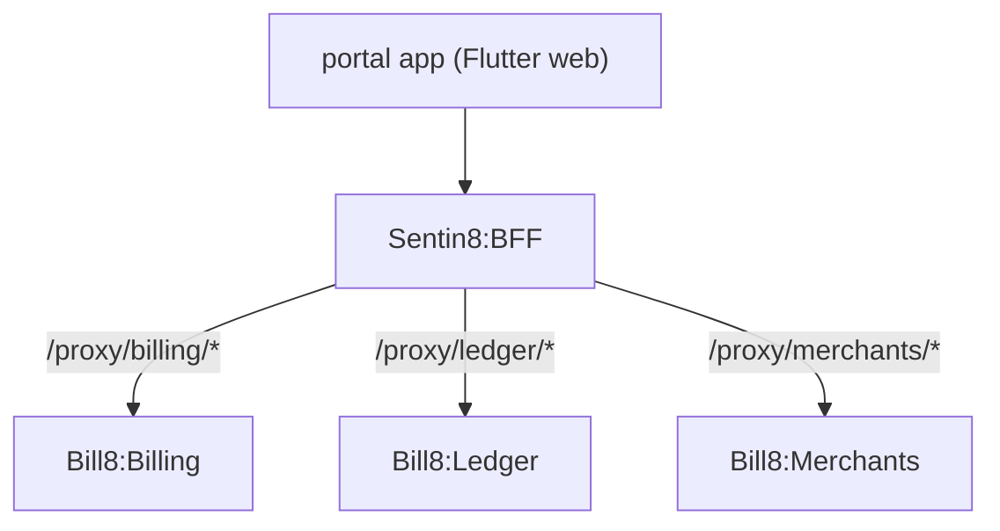

# Bill8:Portal - Flutter App

The customer/seller billing portal: view invoices, manage subscriptions,
and review earnings.

## 1. Summary

Bill8:Portal is the customer- and seller-facing Flutter app. Buyers
view and pay invoices and manage subscriptions; sellers view earnings and
payout details. Every call routes through the BFF proxy.

## 2. Motivation

Customers and sellers need self-service access to their billing and
earnings without the merchant acting as intermediary.

## 3. Architecture & High-Level Design

## 4. Key Traits and Data Structures

- `Bff8ApiClient` - shared BFF client.
- Invoice list/pay, subscription management, earnings/payout views.

## 5. Rationale, Trade-offs, and Alternatives

- **BFF proxy only** - no direct service calls.

## 6. Internal Implementation & Invariants

- All calls route through `Bff8ApiClient`.

## 7. Unresolved Questions / Future Designs

- See the vertical `backlog.md`.

---

**Design attribution:** bill8:portal and its underlying concepts were designed by Hamid Jahanzad <Hamid@Jahanzad.com>.
